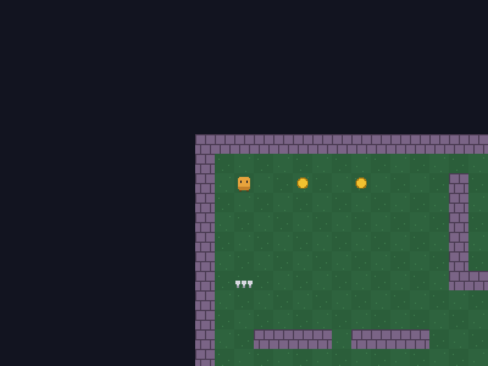
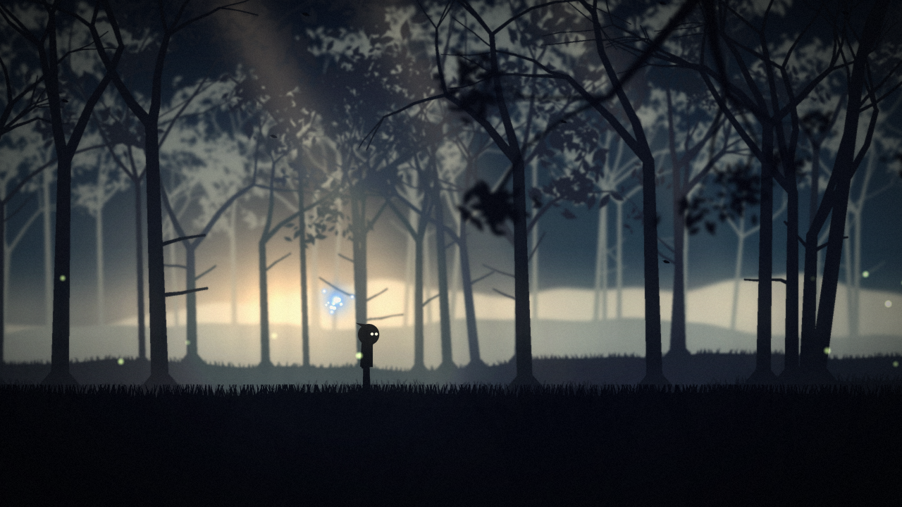

# Dessiner un jeu 2D

Tout ce qui se voit vient de données : une **image découpée en cellules** (un atlas), des entités qui portent un `Sprite`, et éventuellement une entité `Camera`. Le dessin ne change jamais la simulation : un jeu se teste sans fenêtre, et les scénarios vérifient les mêmes valeurs qu'à l'écran.



*`games/treasure_run`, capturé sans fenêtre avec `geplay --headless --screenshot`.*

## Les atlas

Un atlas est un fichier JSON qui nomme une image PNG et la taille d'une cellule ; l'image est une grille de cellules identiques, numérotées ligne par ligne depuis le coin haut gauche, en commençant à 0.

```json
{ "schema_version": 1, "name": "tiles", "image": "tiles.png", "cell_width": 16, "cell_height": 16 }
```

Le manifeste liste les atlas (`"atlases": ["art/tiles.json"]`). L'ordre compte : le premier est l'atlas 0.

`"filter"` choisit comment l'image est agrandie, réduite ou tournée :
- `"nearest"`, le défaut : chaque pixel reste un carré net, pour le pixel art ;
- `"linear"` : l'image est lissée, pour les images peintes, les silhouettes et les dégradés.

Une cellule lissée emprunte un peu des pixels de ses voisines, à son bord. Laissez donc une marge transparente autour du dessin de chaque cellule, ou mettez une grande image seule dans son atlas : une cellule de la taille de l'image, jusqu'à 4096 pixels de côté.

## Les sprites

`sprite2d.Sprite` dessine une cellule, centrée sur `transform2d.Position`.

| Champ | Rôle |
|---|---|
| `atlas` | le **nom** de l'atlas (`"tiles"`) ou son numéro |
| `frame` | numéro de la cellule |
| `width`, `height` | taille dans le monde ; 0 garde la taille de la cellule (une cellule de 16 affichée en 32 reste nette) |
| `layer` | les couches hautes passent devant ; à égalité, l'entité la plus ancienne est dessinée en premier |
| `flip_x` | miroir horizontal |
| `red`, `green`, `blue`, `alpha` | teinte et transparence, 0 à 255 (255 ne change rien) |
| `additive` | ajoute sa lumière à ce qui est dessous : halos, étincelles, rayons ; le noir n'ajoute rien |
| `multiply` | assombrit ce qui est dessous de sa couleur : ombres, voiles colorés ; le blanc ne change rien |

`transform2d.Rotation` (`angle`, en degrés, dans le sens des aiguilles d'une montre à l'écran) tourne l'image autour de sa `Position` : le pivot reste en place, comme une main qui tient une épée. `transform2d.Scale` l'agrandit. Les collisions ne changent ni avec l'un ni avec l'autre.

`sprite2d.SpriteAnimation` fait défiler `frame_count` cellules à partir de `first_frame`, `ticks_per_frame` ticks chacune, en boucle ou non. Elle avance avec la **simulation** (pas avec l'horloge de l'écran) : une animation est identique à chaque exécution et testable dans un scénario.

### Animer selon l'état

Un personnage court, saute, retombe : son animation dépend de ce qu'il fait. `sprite2d.Animator` (`set` : un nom de la liste `animation_set` du jeu) choisit, à chaque tick, parmi les `sprite2d.AnimationClip` de son ensemble. Un clip est une entité à part, qui ne dessine rien :
- ses cellules : `first_frame`, `frame_count`, `ticks_per_frame`, `looping`, comme une `SpriteAnimation` ;
- sa condition : un nombre de l'entité animée (`field`, par exemple `"transform2d.Velocity.y"` ou `"collision2d.Blocked.below"`, un booléen valant 0 ou 1) entre `min` et `max` ; avec `absolute`, la taille du nombre, quel que soit son signe (une vitesse dans un sens ou dans l'autre). Un clip sans `field` vaut toujours : c'est celui qui joue quand rien d'autre ne vaut ;
- `priority` : parmi les clips qui valent, le plus prioritaire gagne (puis le plus ancien).

Changer de clip le reprend à sa première cellule ; rester sur le même le laisse continuer. Plusieurs entités partagent un ensemble : tous les ennemis d'une sorte, toutes les copies d'un préfab. Le héros de `lueur` :

| clip | priorité | condition | cellules |
| --- | --- | --- | --- |
| monte | 3 | `transform2d.Velocity.y` au plus -60 | 20 |
| tombe | 2 | `collision2d.Blocked.below` au plus 0.5 (pas de sol) | 21 |
| court | 1 | `transform2d.Velocity.x`, en taille, au moins 30 | 8 à 19 |
| debout | 0 | aucune | 0 à 7 |

`sprite2d.Facing` tourne l'image vers où va l'entité (sa vitesse en x, ou un autre nombre avec `field`) : à droite au-dessus de `threshold`, à gauche en dessous de `-threshold`, et entre les deux elle garde son côté. `drawn_left` dit que l'image elle-même regarde à gauche.

### Suivre quelqu'un

Le module `follow2d` fait glisser une entité vers une place près d'une autre : `follow2d.Follow` (`target`, une étiquette `tag.Tag`, ou `owner` pour son `transform2d.Owner`), décalée de `offset_x`, `offset_y`, en couvrant à chaque tick la part `stiffness` de la distance. Avec `turn`, le décalage en x suit le sens de la cible : un compagnon reste derrière elle, ou devant, de quelque côté qu'elle aille. `wave_x`, `wave_y` et `wave_period` le font flotter autour de cette place (un huit lent). L'esprit de `lueur` en est fait, avec une `light2d.Light` et une traînée d'étincelles (`particles2d`).

## La caméra

Une entité avec `camera2d.Camera` et une `Position` : ce point du monde est au centre de l'écran, et `zoom` agrandit. Sans caméra, une unité du monde vaut un pixel. Pour suivre le héros : `camera2d.CameraTarget` sur lui, `camera2d.CameraFollow` sur la caméra (`stiffness` 1 colle au héros, 0.1 le suit en douceur). S'il y a plusieurs caméras, la plus ancienne est utilisée.

## La parallaxe



*`games/lueur` : un ciel, une crête, trois plans de forêt de plus en plus pâles et flous, trois nappes de brume, le soleil et ses rayons en lumière ajoutée (`additive`), le sol et le héros, et un premier plan qui défile plus vite que le monde. Les plans proches sont dans la pénombre, éclairés par le soleil bas et par la lueur du héros (voir « La lumière »). Toutes les images sont générées par `games/lueur/tools/make_assets.py` (numpy, Pillow) et lissées (`"filter": "linear"`).*

`sprite2d.Parallax` fait d'un sprite un plan lointain : `x` et `y` disent quelle part du mouvement de la caméra il suit.
- 1 bouge avec le monde (sans `Parallax`, c'est le cas) ;
- 0,5 bouge deux fois moins, comme des collines au loin ;
- 0 reste fixe à l'écran, comme le ciel ;
- plus de 1 bouge plus vite que le monde, comme un premier plan entre le joueur et la caméra.

Avec `repeat_x`, l'image est redessinée côte à côte, tous les `width`, sur toute la largeur de la vue : une seule image fait une bande sans fin (collines, nuages, sol). Le zoom s'applique à tous les plans de la même façon. Mettez les plans les plus lointains sur les couches (`layer`) les plus basses.

Un plan de parallaxe `p` montre, quand la caméra est en `C`, son point `C × p` au centre de l'écran. Pour qu'il soit centré au départ d'un niveau où la caméra est en `C0`, placez-le en `C0 × p`.

## La lumière

Le module `light2d` plonge la scène dans la pénombre et l'éclaire par endroits.
- `light2d.Ambient` (sur n'importe quelle entité, la caméra par exemple) allume l'éclairage : `red`, `green`, `blue` sont la couleur de l'obscurité, ce que devient un dessin là où aucune lumière n'arrive (255, 255, 255 ne change rien, un bleu sombre fait une nuit). Sans `Ambient`, pas d'éclairage : les lumières ne font rien.
- `light2d.Light` est une lumière ronde et douce sur l'entité : `radius`, couleur (`red`, `green`, `blue`), `intensity` (0 à 1), décalage (`offset_x`, `offset_y`, une lanterne au-dessus d'une tête). `flicker` (0 à 1) la fait vaciller comme une flamme, `flicker_speed` fois par seconde ; deux lumières ne vacillent jamais ensemble.
- Un sprite est **éclairé** par défaut. `unlit` lui garde ses propres couleurs : un ciel, un plan lointain déjà peint avec sa lumière, un halo. `light` en fait une lumière de la forme de son image (un rai de soleil, une fenêtre allumée) : elle éclaire ce qui l'entoure sans être dessinée elle-même.
- L'interface (`screen`) n'est jamais éclairée.

Comment c'est dessiné : la carte de lumière est remplie de la couleur ambiante, puis chaque lumière y est ajoutée. Les dessins éclairés sont multipliés par elle ; les autres sont dessinés tels quels, dans l'ordre des couches. Tout se fait avec les modes de mélange de base de SDL et des textures cibles : cela marche avec tous les pilotes, rendu logiciel compris (celui des captures sans tête et de la CI). La lumière ne touche pas la simulation.

## Les particules

Le module `particles2d` fait de la poussière, des étincelles, des braises, de la fumée, de la pluie, de la neige, des feuilles qui tombent, des lucioles ou un éclat quand quelque chose se brise. Un `particles2d.Emitter` sur une entité laisse sortir `rate` particules par seconde (et `burst` d'un coup quand il apparaît : une explosion est une entité avec un `burst`, un `rate` de 0 et une courte vie, module `lifetime`), depuis une zone (`area_width` × `area_height`) autour de l'entité.
- Chacune vit `lifetime` secondes et part à `speed` dans la direction `angle` (en degrés : 0 vers la droite, 90 vers le bas, -90 vers le haut), plus ou moins la moitié de `spread`. `gravity_x`/`gravity_y` l'attirent, `drag` la freine, `wander` la fait onduler comme une luciole ou une feuille.
- Elle passe de `size` à `end_size`, a une couleur (`red`, `green`, `blue`, `alpha`) et, avec `fade`, apparaît et disparaît en douceur. Sans `atlas`, c'est un disque doux ; avec, une image de l'atlas (`frame`).
- `additive` ajoute sa lumière, `unlit` la garde hors de la pénombre de `light2d`, `light` en fait une petite lumière. `layer` la place parmi les sprites, comme un `Sprite`.

Les particules ne sont pas des entités : rien dans le jeu ne peut les lire, et elles ne comptent pas dans l'empreinte de la simulation. Elles avancent pourtant au rythme des ticks et tirent leur hasard d'une graine à elles : deux parties identiques montrent les mêmes particules.

Un module qui veut dessiner parmi les sprites, sur une couche, ajoute ses dessins à `sprite2d::layered_draws(world)` (`ge/mod/sprite2d/layered.hpp`) avant `sprite2d.draw` : c'est ce que fait `particles2d`.

## Faire trembler la caméra

`camera2d.CameraShake` sur la caméra : tant que `strength` est au-dessus de 0, l'image bouge d'au plus `strength` unités dans tous les sens, `speed` fois par seconde, et `strength` baisse de `decay` par seconde. Un jeu fait trembler la caméra en mettant `strength` (une chute, un coup, une explosion) ; la `Position` de la caméra ne bouge pas, seul le dessin tremble.

## Les effets d'écran

Le module `postfx` ajoute à l'image du monde ce qu'y ajouterait un objectif. `postfx.Effects` (sur la caméra, par exemple ; seul le plus ancien compte) :
- `bloom` (0 à 1) : ce qui est clair rayonne doucement autour de lui ;
- `vignette` (0 à 1) assombrit les coins, à partir de `vignette_size` (la part du chemin du centre à un coin où cela commence) ;
- `grain` (0 à 1) : un grain fin qui bouge, comme sur une pellicule ;
- `tint_red`, `tint_green`, `tint_blue` multiplient toutes les couleurs (255 ne change rien : une nuit froide est bleue, un soir chaud orangé) ; `lift_red`, `lift_green`, `lift_blue` sont ajoutés partout (les ombres prennent cette couleur) ;
- `letterbox` (0 à 1) : la part de la hauteur couverte par des bandes noires en haut et en bas, pour une cinématique (un tween peut les faire entrer et sortir).

L'interface (`screen`) est dessinée après les effets, qui ne la touchent jamais. Tous ces effets n'utilisent que les modes de mélange de base de SDL : ils marchent avec tous les pilotes, rendu logiciel compris. Le halo, par exemple, réduit l'image deux fois (ce qui la lisse), la multiplie par elle-même pour ne garder que ce qui est clair, puis l'agrandit et l'ajoute.

## Les tuiles

Il n'y a pas de type « carte de tuiles » : une tuile est une entité avec `Position` et `Sprite`, et un mur y ajoute un `Collider`. Pour un grand niveau, écrire la scène à la main est pénible ; on la génère depuis une carte en texte, comme `games/treasure_run/tools/make_assets.py` (le script produit aussi les images). Le fichier généré est versionné et validé comme les autres.

## Les collisions

Le module `collision2d` ne dépend pas du dessin : il travaille sur les positions et fonctionne à l'identique sans fenêtre.

- `Collider` : une boîte (`width`, `height`) centrée sur la `Position`. `layer` dit ce qu'est l'entité, `mask` à quelles couches elle réagit (ensembles de bits : 1, 2, 4, 8…). `solid` en fait un mur.
- `Body` : l'entité est repoussée hors des murs solides par le chemin le plus court et perd la vitesse qui allait dans le mur (elle glisse le long). Un corps qui avance de plus que sa propre taille en un tick peut traverser un mur mince : gardez des murs au moins aussi épais.
- `Pushable` : un mur solide qu'un `Body` pousse en marchant contre son côté. Il avance tant que la voie est libre (un autre solide de son `mask` l'arrête, et le corps avec lui). `speed` est la vitesse la plus grande à laquelle on le pousse : le corps avance alors à cette vitesse (une caisse lourde). Par-dessus, c'est un sol ordinaire. Avec un `Body` et une `gravity2d.Gravity`, il tombe quand on le pousse au-delà d'un bord.
- `Contacts` : rempli à chaque tick pour une entité qui a aussi un `Collider` : `count` (combien de boîtes la touchent) et `layers` (leurs couches réunies). Deux boîtes qui ne partagent qu'un bord ne se touchent pas.

La détection trie les boîtes par bord gauche et balaie : le coût suit le nombre de contacts, pas le carré du nombre de boîtes.

## Le texte

Une entité avec `text2d.Text` affiche l'un des textes du jeu, lettre par lettre, avec une police (un atlas qui a `glyphs`) : voir [MANIFEST.md](MANIFEST.md) pour les fichiers de langue. Avec `screen: true` (aussi pour `Sprite`), la position et la taille sont en pixels de la fenêtre et la caméra n'agit pas : c'est ainsi qu'une interface reste en place pendant que le monde défile. `{value}` dans un texte écrit le nombre du champ `value`.

Un `Sprite` a un `pivot_x` et un `pivot_y` (0,5 par défaut : le milieu de l'image sur la `Position`) ; 0 met le bord gauche ou haut sur la `Position`, 1 le bord droit ou bas. Il faut une taille (`width`, `height`) pour que le pivot ait un effet. Les barres de `ui` s'en servent pour grandir depuis un bord. L'interface complète (ancrage, grilles, menus, inventaire) est décrite dans [UI.md](UI.md).

## Voir un jeu

```
geplay games/treasure_run/game.json                      # fenêtre, flèches ou WASD
geplay games/treasure_run/game.json --headless --frames 60 --screenshot image.bmp
```

Voir [PLATFORM.md](PLATFORM.md). Le choix de `SDL_Renderer` et sa mesure : [ADR 0008](adr/0008-rendu-2d-sdl-renderer-derriere-renderer.md), [ADR 0015](adr/0015-rendu-atmospherique.md).

## Un mouvement fluide sur tous les écrans

La simulation avance par ticks fixes (60 par seconde par défaut), alors qu'un écran se rafraîchit 60, 120 ou 144 fois par seconde. Dessiner le dernier tick tel quel ferait avancer les choses par petits sauts. Quand le jeu tourne en temps réel (`geplay`, le lanceur, un jeu exporté), chaque entité est donc dessinée **entre sa position du tick précédent et celle du dernier tick**, au prorata du temps écoulé (`Time::alpha`). La caméra aussi, ce qui supprime les saccades du défilement. Le dessin a ainsi un tick de retard (1/60 s), comme dans tous les moteurs qui font ainsi.

Un déplacement de plus de `snap_distance` unités en un tick (réglage de `transform2d`, 256 par défaut) est un saut : téléportation, passage d'un bord de l'écran à l'autre, nouveau niveau. Il est dessiné d'un coup, sans glisser à travers l'écran.

Rien de cela ne touche la simulation. Les tests et les scénarios voient exactement le dernier tick (`Time::interpolate` n'y est pas mis), et un module de dessin obtient la position à dessiner avec `transform2d::drawn_position` (`ge/mod/transform2d/drawn.hpp`).

## Pas encore

L'[ADR 0015](adr/0015-rendu-atmospherique.md) prévoit encore des effets à shader (étalonnage par table de couleurs, flou), là où le pilote le permet.

- **Polices TrueType** : le texte se dessine avec des polices en atlas PNG ; lire un `.ttf` directement viendra plus tard.
- **Cartes de tuiles en tableau** : une tuile reste une entité.
- Ordre de dessin par la position verticale ; ombres portées par les lumières.
