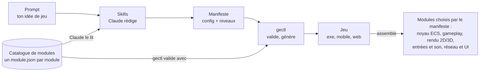
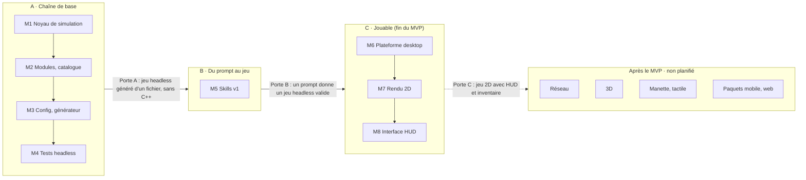

# Roadmap — moteur de jeu piloté par configuration

> Ce fichier est la référence de la roadmap : il vit avec le code et se met à jour par pull request.
> Dernière mise à jour : 2026-11-17. Décisions D1 à D7 validées le 2026-11-17.

## Vision et principes

Le but est qu'un prompt (« fais-moi un jeu de survie en 2D, solo ») produise un jeu qui compile et tourne, en passant par un fichier de configuration que Claude écrit et que le moteur transforme en instance de jeu.

Pour que ce soit fiable, le moteur doit offrir trois garanties :

- **Un catalogue fini et décrit de modules.** Chaque système, composant, mode d'affichage ou d'entrée est un module avec un nom, des paramètres typés, des dépendances et une documentation lisible par une machine. Sans cela, Claude invente des noms qui n'existent pas.
- **Une validation stricte et rapide.** Le fichier de config est vérifié avant toute compilation : module inconnu, paramètre manquant, dépendance absente ou conflit (ex. deux systèmes de rendu). L'erreur est claire, pour que Claude puisse la corriger seul.
- **Une extension sans toucher au cœur.** Quand le catalogue ne suffit pas, Claude écrit un nouveau module (composant + système + sa fiche) qui s'enregistre lui-même, et la CI le valide comme tout le reste.

Trois principes en découlent :

1. **La config décrit, le code exécute.** La config ne contient aucune logique ; la logique de jeu vit dans les modules.
2. **Tout ce qu'un module fait est observable et testable sans fenêtre** (mode headless, rejeu déterministe), ce qui permet à Claude de vérifier un jeu qu'il a généré.
3. **Du plus simple au plus ambitieux.** Le MVP est un jeu 2D solo ; le réseau et la 3D n'y sont pas, mais l'architecture est contrainte dès le début pour ne pas les bloquer (voir les garde-fous).

## Architecture cible

Le manifeste est l'objet central : Claude l'écrit en s'appuyant sur le catalogue, `gectl` le vérifie contre ce même catalogue, puis assemble un jeu qui ne contient que les modules demandés. Le cœur ECS reste le même pour tous les jeux ; c'est la liste de modules qui change.

## Décisions à trancher avant de coder

Sept choix structurent tout le reste ; voici la recommandation retenue pour chacun. Aucun n'est irréversible s'il est caché derrière une interface (le format de config en particulier).

| # | Décision | Recommandation | Pourquoi |
| --- | --- | --- | --- |
| D1 | Format du manifeste | **JSON validé par un JSON Schema**, un fichier par jeu et un par niveau, reliés par des références (`include`, `next_level`). Le Markdown reste pour les documents de conception, pas pour la config. | Claude écrit du JSON de façon fiable, et un schéma donne des erreurs précises et l'autocomplétion. Un format custom coûterait un parseur, une doc et des bugs sans rien apporter. |
| D2 | Quand la config est lue | **Deux temps.** À la compilation : quels modules sont inclus (binaire petit, utile pour mobile et web). À l'exécution : niveaux, valeurs d'équilibrage, préfabs. | Changer un niveau ou une vitesse ne doit pas relancer une compilation C++ ; choisir 2D ou 3D, si. |
| D3 | Qui lit le JSON | Un **outil séparé, `gectl`**, hors du cœur (il peut utiliser exceptions et RTTI). Le cœur reste sans exceptions ni RTTI. | Évite d'imposer une lib JSON au moteur ; le générateur produit du C++ simple. |
| D4 | Qu'est-ce qu'un module | Un dossier avec un fichier **`module.json`** (nom, version, composants, systèmes, paramètres typés, dépendances, conflits, plateformes, doc courte) + son code C++, **lié statiquement**. | Pas de chargement dynamique : iOS et le web l'interdisent ou le compliquent. Le `module.json` est ce que Claude lit. |
| D5 | Réflexion sur les composants | Les champs des composants sont **déclarés dans `module.json`** et le code d'enregistrement et de sérialisation en est généré. | C++20 n'a pas de réflexion. Il en faut pour définir des entités en données, sauvegarder, répliquer en réseau. |
| D6 | Fenêtre, entrées, audio | **SDL3** derrière des interfaces du moteur. Le choix du rendu (2D maison, bgfx, SDL GPU) est tranché par un petit test technique au jalon M7. | SDL couvre desktop, mobile et web. Le choix du rendu est pris pour la 2D ; l'interface de rendu doit laisser la porte ouverte à la 3D. |
| D7 | Réseau et 3D (hors MVP) | Aucun développement dans le MVP, mais **dès le jalon M1** : pas de temps fixe, hasard avec graine, état du monde copiable. | Ces contraintes coûtent peu aujourd'hui et gardent possibles le réseau (prédiction, rejeu, rollback) et la 3D ; des tests les vérifient (voir les garde-fous). |

## Roadmap par jalons

Le MVP est un **jeu 2D solo sur desktop, défini par config, du prompt au jeu jouable** (jalons M0 à M8). Le réseau, la 3D, la manette, le tactile et les paquets mobile et web ne sont pas planifiés : ils sont couverts par des garde-fous d'architecture (section suivante), pour qu'aucune de ces portes ne se ferme. Le parti pris : prouver la chaîne complète (prompt, config, jeu vérifié) sans rien afficher avant d'ajouter fenêtre et rendu. Chaque jalon passe la CI et a un critère de sortie vérifiable. Pas de durées.

1. **M0 — Fondations (fait).** ECS, `App`, plugins, CI sur 6 plateformes. *Sortie : CI verte sur `main`.*
2. **M1 — Noyau de simulation.** Boucle à pas fixe et temps, commandes différées (modifier le monde pendant une itération), événements, ordre des systèmes par dépendances, hasard à graine, copie du monde. *Sortie : deux exécutions avec la même graine donnent le même état, et une copie du monde égale l'original.*
3. **M2 — Modules et catalogue.** Format `module.json` et son schéma, descripteurs de composants générés, registre de modules, commande `gectl catalog` qui sort tout en JSON, vérification en CI qu'un module n'utilise que ses dépendances déclarées. *Sortie : 2 modules d'exemple listés dans le catalogue, schéma vérifié en CI.*
4. **M3 — Jeux en JSON (fait).** Manifeste, préfabs et scènes (tout est entité), `gectl validate` (messages localisés avec suggestions), `gectl schema` (autocomplétion éditeur), lanceur universel `gerun`. *Sortie : un jeu minimal tourne depuis des fichiers, sans écrire de C++.* Reporté : `gectl build` est remplacé par l'**export** (un binaire avec seulement les modules utilisés, données compactes) ; références entre entités ; `gectl fmt` qui conserve les commentaires ; modules pilotés par les données (cinématiques, histoire, dialogues, déclencheurs).
5. **M4 — Harnais de test sans fenêtre (fait).** Exécution headless avec un rendu « nul », actions d'entrée scriptées, empreinte du monde, scénarios déclarés dans le manifeste (« après 300 images, le score est > 0 »). *Sortie : la CI lance les jeux de référence et leurs scénarios.* Fait : actions (`Actions`) et entrée scriptée, fichiers de scénarios validés, `gerun --test` (chaque scénario joué deux fois), rendu nul et enregistreur, jeux `sparks` et `pilot`.
6. **M5 — Skills v1 : du prompt au jeu.** Voir la section sur le pipeline. *Sortie : un prompt donne un jeu headless validé, y compris avec un nouveau module écrit par Claude.*
7. **M6 — Plateforme desktop.** Fenêtre, boucle, clavier et souris, audio, via SDL3 ; couche d'actions d'entrée dont l'association touches-actions est dans la config. *Sortie : un sprite déplacé par des actions sur Windows, aussi bien au clavier que par le backend scripté.*
8. **M7 — Rendu 2D.** Sprites, atlas, caméra, tuiles, texte, animation, collisions 2D. *Sortie : jeu de référence 2D entièrement défini par config.*
9. **M8 — Interface.** HUD, menus, inventaire pilotés par données. *Sortie : jeu de référence avec HUD et inventaire. C'est la fin du MVP.*

**Après le MVP, non planifié :** réseau, 3D, manette et tactile, paquets Android, iOS et web. Le jour où tu voudras en lancer un, il deviendra un jalon qui ajoute des modules, sans modifier le noyau ni les jeux existants. La section suivante liste ce qui est imposé dès maintenant pour que ce soit vrai.

## Garde-fous d'architecture

Réseau, 3D, nouvelles plateformes et nouvelles entrées ne sont pas dans le MVP, mais chacun impose une contrainte qui coûte peu aujourd'hui et beaucoup si on l'oublie. Chaque ligne a une vérification automatique : si elle casse, on corrige avant d'avancer.

| Besoin futur | Contrainte imposée dès le MVP | Comment on le vérifie |
| --- | --- | --- |
| Réseau | Simulation à pas fixe et déterministe ; hasard à graine ; état du monde copiable et sérialisable ; la logique de jeu ne lit que des actions horodatées par image, jamais un clavier ni une horloge ; chaque composant dit dans `module.json` s'il est réplicable. | Test d'empreinte (même graine et mêmes actions donnent le même état) et test de copie du monde, en CI dès M1 et M4. |
| 3D | Le rendu est un module derrière une interface, jamais appelé par la logique ; positions 2D et 3D sont des composants distincts et un système de gameplay déclare celui qu'il utilise ; un jeu doit tourner sans module de rendu. | Les jeux de référence passent en headless avec un rendu « nul » ; un rendu « enregistreur » qui note les appels de dessin prouve que l'interface ne fuit pas. |
| Autres plateformes (mobile, web) | Aucun code de plateforme dans le noyau ni dans les modules de gameplay ; fichiers, temps et sons via des interfaces ; liaison statique, pas de chargement dynamique. | La CI compile déjà le noyau pour Android, iOS et WebAssembly à chaque pull request ; les modules de gameplay y seront ajoutés dès M2. |
| Autres entrées (manette, tactile) | La logique ne connaît que des actions (« avancer », « valider ») ; la config associe actions et touches, boutons ou gestes ; chaque backend produit des événements normalisés. | Deux backends alimentent le même jeu, le clavier et un backend scripté ; le jalon M6 les fait passer tous les deux. |
| Nouveaux modules sans toucher au cœur | Un module n'inclut que ce que son `module.json` déclare ; ajouter un module = un dossier + son enregistrement. | Test de flux de plugin déjà en place ; vérification des inclusions en CI à partir de M2. |

À la fin de chaque phase, on repasse ce tableau en revue : une contrainte violée se corrige avant la phase suivante.

## Le pipeline du prompt au jeu

Ce qui se passe quand tu demandes un jeu, une fois M5 atteint. Chaque étape a une commande de `gectl` qui donne à Claude un résultat vérifiable plutôt qu'une impression.

1. **Cadrer.** Le skill pose au plus quelques questions (2D ou 3D, solo ou réseau, entrées, plateformes) et choisit un modèle de genre de départ (plateforme, vue de dessus, tour par tour…).
2. **Lire le catalogue.** `gectl catalog --json` donne les modules réellement disponibles. Claude ne cite que ceux-là.
3. **Écrire le manifeste et les niveaux.** Claude produit les fichiers de config.
4. **Valider.** `gectl validate` renvoie des erreurs précises (module inconnu, paramètre hors bornes, dépendance manquante, conflit). Claude corrige et recommence jusqu'à zéro erreur.
5. **Combler un manque si besoin.** Si aucune brique ne convient, Claude crée un module avec `gectl new-module` : `module.json`, composants, systèmes, test et fiche. Il passe par une pull request et la CI, comme tout le reste.
6. **Compiler.** `gectl build` génère l'instance du jeu et la compile.
7. **Jouer sans fenêtre.** `gectl playtest` lance les scénarios du manifeste avec des entrées scriptées et vérifie les conditions annoncées.
8. **Montrer et itérer.** Tu essaies le jeu ; tes retours modifient la config, et rarement le code.

Skills à écrire (un par ligne de ce pipeline) :

- `game-from-prompt` : le déroulé complet ci-dessus.
- `engine-catalog` : lire et interpréter le catalogue, choisir des modules compatibles.
- `add-module` : créer un module conforme (modèle de dossier, schéma, test obligatoire).
- `playtest-headless` : écrire des scénarios et lire leurs échecs.
- `add-level` : ajouter des niveaux et des liens entre niveaux.

## Risques

Le risque principal est de vouloir « n'importe quel jeu » trop tôt : l'ambition 3D plus réseau plus mobile, dès le départ, ferait échouer la chaîne avant qu'elle fonctionne une fois.

| Risque | Réponse prévue |
| --- | --- |
| Claude invente un module ou un paramètre qui n'existe pas | Catalogue lisible par machine et `gectl validate` obligatoire avant toute compilation |
| Trop de combinaisons de modules possibles, certaines cassées | Champs `conflits` et `dépendances` dans `module.json` ; matrice CI sur les jeux de référence (un par genre) |
| Le moteur devient un monstre de généricité | Un module n'entre au catalogue que s'il sert un jeu de référence ; le cœur reste petit |
| Itération lente (recompiler à chaque essai) | Niveaux, valeurs et préfabs lus à l'exécution ; rechargement à chaud en option plus tard |
| Code généré ou module écrit par Claude qui plante | Modèles de dossier, test obligatoire par module, CI (sanitizers, clang-tidy) sur chaque PR |
| Une décision du MVP bloque plus tard la 3D ou le réseau | Garde-fous d'architecture vérifiés par des tests et revus à la fin de chaque phase |
| Réseau impossible à ajouter après coup | Contraintes de déterminisme et de copie du monde dès M1 |

## Statut

- M0 : fait.
- M1 : fait (simulation déterministe, pas fixe, commandes, événements, ordre des systèmes, copie et empreinte du monde).
- M2 : fait (`module.json` et schéma, code généré, `gectl check/catalog/generate`, 3 modules d'exemple, vérifications en CI). Détail dans `docs/MODULES.md`.
- M3 : à venir.
