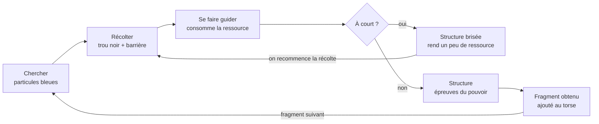

# Complete Universe — Fiches fragments

Version finale · 24 novembre 2026

Complément du GDD (`complete-universe-gdd.md`) : le détail de chaque pouvoir, de chaque fragment et des règles qui les relient.

---

## Règles communes

Chaque fragment suit le même cycle : récolter sa ressource, la dépenser pour être guidé jusqu'à sa structure, réussir la structure, recevoir le pouvoir.

**Cycle d'un fragment**

1. Le Bleu montre où trouver la ressource de la couleur tenue dans l'autre main, en consommant de l'Écho originel en continu.
2. Le joueur récolte la ressource du prochain fragment (trou noir + barrière), sans avoir encore son pouvoir.
3. Seuil atteint (environ 100 unités, à équilibrer) : des particules filent vers la structure, souvent loin dans l'espace, en consommant cette ressource en continu.
4. Ressource épuisée avant l'arrivée : la structure se brise et libère un peu de cette ressource. Retour à l'étape 2.
5. Arrivée : la structure. On ne peut pas y mourir : elle limite l'usage du Noir et du Blanc sans jamais vider le stock.
6. La structure prête son pouvoir pour ses épreuves. À la fin, le fragment entre dans la main et s'ajoute au torse.

La seule façon d'échouer est de manquer de ressource pendant le guidage : la structure se brise et le joueur repart récolter.

**Ordre semi-libre**

| Palier | Fragments | Pourquoi |
| --- | --- | --- |
| 0 — tutoriel | Noir, Blanc | Pouvoirs de base, appris sur la planète dans la barrière |
| 1 — imposé | Bleu | Sans lui, impossible de trouver les autres |
| 2 — au choix | Vert, Rouge, Jaune | Pouvoirs physiques : agir sur la matière et l'environnement |
| 3 — au choix | Orange, Violet | Pouvoirs abstraits : le temps et les dimensions ouvrent le monde au-delà de la 2D |
| 4 — imposé | Rose | Dernier fragment, il prépare la fusion |
| Finale | Structure finale | Les 7 fragments fusionnent avec le personnage |

Dans un palier, le Bleu guide vers la couleur tenue dans l'autre main.

**Ressources (une par pouvoir)**

| Pouvoir | Ressource | Où la trouver | Rareté |
| --- | --- | --- | --- |
| Noir | Matière (roche, métal, tout solide) | Partout | Très commune |
| Blanc | Carbone | Astéroïdes carbonés, planètes mortes, fossiles | Commune : c'est la vraie barre de vie |
| Bleu | Écho originel | Vide profond, loin des étoiles | Moyenne |
| Vert | Biomasse | Planètes vivantes, créatures | Commune dans les régions vivantes |
| Rouge | Matière instable | Volcans, restes de supernova | Rare, dangereuse à récolter |
| Jaune | Photons | Près des étoiles | Abondante près des étoiles, nulle entre elles |
| Orange | Chronocristaux | Près des trous noirs massifs | Rare |
| Violet | Matière exotique | Failles et anomalies spatiales | Rare |
| Rose | Résonance | Autour des êtres conscients et des civilisations | Variable |

---

## Noir — Gravité

Pouvoir de départ, appris dans le tutoriel. C'est le pouvoir le plus utilisé : il sert à marcher, sauter, récolter et détruire.

| Point | Règle |
| --- | --- |
| Ciblage | Le point visé à la souris |
| Portée et durée | Portée courte. Continu tant qu'on appuie : le trou noir grossit, devient plus fort et coûte plus |
| Ce qu'il touche | Décor, ressources, objets, petits ennemis. Jamais les structures des fragments |
| Coût | Matière, par seconde. Presque rien pour marcher et rester en vie, beaucoup pour détruire |
| Noir seul ou avec Blanc | Le Noir seul anéantit ce qu'il absorbe et ne rend que de la matière. Noir + Blanc récolte sans perte, dans une bulle, et range la ressource triée dans l'inventaire |
| Sans Noir | Les bords de l'écran blanchissent ; à zéro, le personnage ne peut plus bouger, il meurt |
| Utile plus tard | Toujours : déplacement, récolte, destruction |
| Civilisation | Aucune pour le Noir seul. Noir + Blanc : les Tisseurs, des villes faites de bulles en orbite |
| Son et motif | Son grave qui aspire ; spirale sur le bras |

**Fusions** : + Blanc = récolte et inventaire, avec une touche dédiée qui met automatiquement Noir et Blanc dans les mains, puis rend les couleurs d'avant une fois la récolte finie. + Bleu = vue panoramique : la caméra dézoome sur toute la planète pour repérer gisements et ennemis avant d'avancer.

**Règles** : la bulle de récolte grandit tant qu'on appuie, mais coûte d'autant plus ; les ressources arrivent dans l'inventaire une fois la récolte finie. Entrer dans un trou noir consume le personnage petit à petit. Créer un trou noir puis l'absorber est toujours à perte.

---

## Blanc — Barrière

Pouvoir de départ, appris dans le tutoriel. Ce qui est dans une barrière ne subit rien de l'extérieur, pas même le temps. Son carbone est la vraie barre de vie.

| Point | Règle |
| --- | --- |
| Ciblage | Clic : une bulle autour du point visé, qui grossit tant qu'on appuie. Clic glissé : une barrière plane entre deux points |
| Portée et durée | Portée moyenne. Une barrière posée reste. Jusqu'à 3 barrières en même temps : la plus ancienne disparaît |
| Ce qu'il touche | Tout, y compris le personnage. Abrité dans sa barrière, il est intouchable mais ne peut plus rien faire dehors |
| Coût | Carbone, selon la taille, au moment de la poser |
| Règle générale | Une barrière bloque tout pouvoir venu de l'extérieur, sauf la lumière qui la traverse et le laser qui rebondit |
| Sans Blanc | Les bords de l'écran noircissent ; à zéro, le personnage est consumé par son propre trou noir |
| Utile plus tard | Toujours : protection, récolte, portes de couleur, fusions |
| Civilisation | Aucune pour le Blanc seul ; voir Noir + Blanc |
| Son et motif | Son cristallin ; hexagones sur le bras |

**Fusions** : + Noir = récolte et inventaire, avec la touche dédiée décrite dans la fiche Noir. + Bleu = zone d'analyse : tout ce qui traverse la barrière est scanné. Usage : une alarme qui signale l'arrivée d'un ennemi ou révèle une ressource qui passe.

---

## Bleu — Perception

Premier fragment, imposé : il apprend à chercher et rend possible tout le reste du jeu.

- **Pouvoir** : la main bleue émet des particules qui filent vers les gisements de la couleur tenue dans l'autre main. Une fois le seuil d'un fragment atteint, elles filent vers sa structure.
- **Ressource** : Écho originel. C'est la lumière laissée par le Big Bang, donc par l'explosion du personnage. On la trouve dans le vide profond, sous forme d'un léger grésillement bleu qu'une bulle de trou noir absorbe.
- **Avant d'avoir le Bleu** : une lumière dans le ciel, visible de partout, sert de guide. Ce premier guidage ne consomme rien.
- **Région** : une ceinture d'astéroïdes chaotique, un seul minerai par astéroïde. Gravité faible et sauts nombreux : on y apprend les mini-trous noirs, les barrières contre les collisions et la gestion des ressources.
- **Ennemis** : aucune vie encore. Astéroïdes en collision, essaims de débris attirés par la gravité du personnage, petits trous noirs errants à enfermer dans une barrière, sentinelles d'une civilisation disparue qui sabotent les gisements.
- **Couleurs ajoutées** : étoiles froides et nébuleuses bleutées ; le fragment bleu apparaît sur le torse.

**Structure : l'Observatoire** (formée par le fragment). Un immense cristal bleu dont les chemins sont invisibles sans perception.

1. **Entrée aveugle** : couloirs noirs ; seules les particules du fragment révèlent le chemin, quelques secondes à la fois.
2. **Plateformes fantômes** : elles n'existent que lorsqu'elles sont perçues. Il faut les révéler, puis sauter avant qu'elles ne disparaissent.
3. **Les trois éclats** : trouver trois cristaux cachés en suivant les particules, puis les ramener au cœur de la structure.
4. **Fin** : le fragment entre dans la main, la caméra dézoome sur la ceinture entière.

**Fiche technique**

| Point | Règle |
| --- | --- |
| Ciblage | Aucun : les particules partent de la main bleue vers la cible correspondant à la couleur de l'autre main |
| Portée et durée | Portée illimitée (une direction, pas une distance). Un clic l'active, un clic l'arrête |
| Ce qu'il touche | Rien : il ne fait que guider |
| Coût | Par seconde : Écho originel pour chercher une ressource, ressource du fragment pour guider vers sa structure |
| Récolte de l'Écho | Le personnage en absorbe un peu tout seul pendant chaque voyage spatial ; on en trouve davantage sur les astres morts, loin des étoiles |
| Avant le déblocage | La ceinture est grise ; les gisements d'Écho apparaissent comme un grésillement blanc ; la lumière du ciel est blanche |
| Utile plus tard | Toujours : il guide vers tous les fragments |
| La structure suppose | Noir et Blanc |
| Civilisations | Bleu : les Veilleurs, qui vivent dans des observatoires et fuient le personnage. Bleu + Noir : un peuple de planètes-lentilles. Bleu + Blanc : des sentinelles qui posent des zones d'analyse comme alarmes |
| Biomes spéciaux | Champ de débris en rotation, astéroïde creux, nuage de poussière qui cache tout |
| Son et motif | Son aigu et scintillant ; points sur le bras |

**Fusions**

| Avec | Effet |
| --- | --- |
| Noir | Point focal de clairvoyance : vue panoramique (la caméra dézoome sur la région) |
| Blanc | Zone d'analyse : tout ce qui entre ou sort de la barrière est scanné ; elle révèle une couleur non débloquée et rend sa ressource visible |
| Autres couleurs | Indique la direction de la ressource de cette couleur |

**Règle** : Bleu + une couleur indique toujours la direction de la ressource de cette couleur, une couleur à la fois, rien de plus.

---

## Vert — Évolution

Palier 2, au choix : c'est la région où la vie apparaît, et le premier pouvoir qui construit au lieu de détruire.

- **Pouvoir** : accélère le développement biologique ou géologique d'une zone. Faire pousser un arbre géant pour grimper, des cristaux comme plateformes, rendre un sol stérile fertile. Il fait aussi évoluer les ennemis, par exemple les faire grossir pour qu'ils bloquent un passage. Si le lieu n'est pas propice à la vie, la biomasse finit par mourir à nouveau, sauf dans une bulle de Blanc.
- **Ressource** : Biomasse, absorbée sur les planètes vivantes et les créatures.
- **Région** : planètes-jardins, lunes océaniques, astéroïdes couverts de mousse. Les grottes et tunnels y sont remplis de racines.
- **Formes de vie** : premières créatures du jeu.
    - Hostiles : prédateurs qui repoussent le joueur, plantes qui pourrissent la biomasse (sabotage).
    - Passives : herbivores géants dont le dos sert de plateforme mobile.
    - Amicales : petites créatures qui suivent le joueur et s'arrêtent près des gisements.
- **Couleurs ajoutées** : végétation, aurores, océans ; le fragment vert apparaît sur le torse.

**Structure : la Graine-monde** (formée par le fragment). Une graine colossale vivante, dont l'intérieur pousse et se referme.

1. **Racines** : les passages sont fermés. Faire pousser des racines pour créer des ponts.
2. **Dosage** : trop de croissance rebouche le passage. Il faut doser, ou figer une pousse au bon moment avec une barrière (Blanc).
3. **Écosystème** : faire évoluer une créature passive jusqu'à ce qu'elle chasse les prédateurs qui bloquent le cœur.
4. **Fin** : la graine éclot, le fragment entre dans la main.

**Fiche technique**

| Point | Règle |
| --- | --- |
| Ciblage | Une zone autour du point visé |
| Portée et durée | Portée courte. Continu tant qu'on appuie ; ce qui a poussé reste |
| Ce qu'il touche | Plantes, cristaux, roches, êtres vivants (ennemis compris). Pas les constructions |
| Coût | Biomasse, par seconde |
| Récolte | Bulle sur la végétation, les mousses et les créatures vaincues |
| Avant le déblocage | La vie verte paraît grise, comme pétrifiée |
| Utile plus tard | Partout : faire pousser ponts et plateformes, faire grossir un ennemi pour boucher un passage |
| La structure suppose | Noir, Blanc, Bleu |
| Civilisations | Vert : les Jardiniers, dans des cités-arbres. Vert + Noir : un peuple qui purge la vie avec l'anti-biomasse. Vert + Blanc : des nomades qui transportent leurs jardins dans des bulles. Vert + Bleu : des prospecteurs de biomasse |
| Biomes spéciaux | Forêt de champignons géants, océan de mousse en apesanteur, récif de cristaux vivants |
| Son et motif | Craquements de croissance ; nervures de feuille sur le bras |

**Fusions**

| Avec | Effet |
| --- | --- |
| Noir | Anti-biomasse : n'agit que sur la biomasse et n'abîme pas ce sur quoi elle pousse (par exemple d'autres ressources), contrairement à un trou noir ou à un laser |
| Blanc | Bulle-source de Vert, qui peut être déplacée |
| Bleu | Indique la direction de la biomasse |

**Règle** : faire pousser de la biomasse en consomme un peu plus que sa récolte n'en rapporterait. C'est possible, mais toujours à perte.

---

## Rouge — Laser

Palier 2, au choix : la région la plus hostile et le premier vrai pouvoir de combat.

- **Pouvoir** : un rayon continu, très coûteux, qui vaporise la matière ou déclenche des explosions. Il tire là où l'on clique, comme la récolte. Il ouvre des ressources cachées, détruit des obstacles et sert au combat.
- **Ressource** : Matière instable (isotopes radioactifs), dans les volcans et les restes de supernova. La récolter trop vite peut déclencher une explosion.
- **Région** : l'univers devient chaotique. Des tempêtes cosmiques repoussent le joueur, et leurs éclairs brisent ses barrières, ce qui consomme son Blanc.
- **Ennemis** : constructions armées de lasers, tourelles d'une civilisation guerrière, créatures de lave qui sabotent les gisements en les faisant exploser.
- **Couleurs ajoutées** : naines rouges, lave, tempêtes pourpres ; le fragment rouge apparaît sur le torse.

**Structure : la Forge** (construite par une civilisation qui maîtrisait le Rouge). Un réacteur scellé où il faut détruire avec précision.

1. **Murs scellés** : les vaporiser dans le bon ordre. Certains contiennent de la matière instable qui déclenche une réaction en chaîne.
2. **Découpe** : tailler des plateformes dans la roche pour se créer un chemin.
3. **Gardien** : une construction armée d'un laser. Renvoyer ses tirs contre lui avec des barrières pour le faire surchauffer.
4. **Fin** : le réacteur s'éteint, le fragment entre dans la main.

**Fiche technique**

| Point | Règle |
| --- | --- |
| Ciblage | Dans la direction du curseur |
| Portée et durée | Longue portée, jusqu'au bord de l'écran. Continu tant qu'on appuie |
| Ce qu'il touche | Tout, sauf les barrières (il rebondit) et les trous noirs (il disparaît) |
| Coût | Matière instable, par seconde, élevé |
| Récolte | La matière instable chauffe dans la bulle. Récoltée trop longtemps d'affilée, la bulle explose : on perd la prise et on est repoussé. Il faut récolter par petites prises |
| Avant le déblocage | Lave et roches instables grises, qui clignotent en blanc |
| Utile plus tard | Ouvrir des passages et le cœur des planètes, combattre, énigmes de rebond sur barrières dans toutes les régions |
| La structure suppose | Noir, Blanc, Bleu |
| Civilisations | Rouge : un peuple guerrier de forges. Rouge + Noir : des démolisseurs de planètes, à l'origine des champs de débris. Rouge + Blanc : des tailleurs de cristal. Rouge + Bleu : des prospecteurs de matière instable |
| Biomes spéciaux | Plaine de verre volcanique, geysers instables, planète éventrée jusqu'au noyau |
| Son et motif | Bourdonnement électrique ; zigzag sur le bras |

**Fusions**

| Avec | Effet |
| --- | --- |
| Noir | Libère un trou noir instable qui amplifie la destruction : détruit un très gros obstacle d'un coup, à prix fort |
| Blanc | Canalise l'énergie en un laser précis : découpe sans faire exploser la matière instable autour |
| Bleu | Indique la direction de la matière instable |

**Règle** : le laser rebondit sur une barrière et disparaît dans un trou noir.

---

## Jaune — Lumière

Palier 2, au choix : la région la plus sombre. C'est là que le jeu passe le plus nettement d'une ambiance proche de Limbo à une ambiance proche d'Ori.

- **Pouvoir** : une lumière qui émane de la main qui tient le Jaune. Elle éclaire les zones sombres, alimente les structures anciennes (portails, vaisseaux) et manipule les ombres.
- **Ressource** : Photons, abondants près des étoiles et absents entre elles.
- **Région** : des îlots de lumière autour de quelques étoiles, séparés par de grands espaces noirs (nébuleuses obscures, planètes sans étoile). La tension vient de la traversée de ces espaces noirs.
- **Ennemis** : ombres vivantes qui fuient ou attaquent la lumière, créatures aveugles qui chassent au son, vestiges d'une civilisation qui a éteint son étoile.
- **Couleurs ajoutées** : lumière chaude, halos et reflets dorés ; le fragment jaune apparaît sur le torse.

**Structure : le Temple éteint** (construit par une civilisation disparue). Un temple solaire dont les mécanismes n'ont plus d'énergie.

1. **Couloirs noirs** : la lumière révèle le décor, mais attire les ombres.
2. **Ombres solides** : les ombres projetées deviennent des plateformes. On les déplace en déplaçant le personnage, ou une source de lumière posée dans une barrière.
3. **Réalimentation** : renvoyer la lumière vers trois récepteurs grâce à des miroirs fixes du temple.
4. **Fin** : le temple se rallume, le fragment entre dans la main.

**Fiche technique**

| Point | Règle |
| --- | --- |
| Ciblage | Aucun : passif, la lumière émane de la main tant qu'elle tient le Jaune |
| Portée et durée | La taille du halo. Continu |
| Ce qu'il touche | Il révèle le décor et les fresques, déplace les ombres, alimente les mécanismes anciens qu'il touche, repousse les créatures des ténèbres |
| Coût | Photons, par seconde |
| Récolte | La bulle ne se remplit qu'en zone éclairée, près d'une étoile. Plus on est proche, plus elle se remplit vite |
| Avant le déblocage | La lumière chaude paraît blanche ; les mécanismes anciens paraissent éteints et inutiles |
| Utile plus tard | Partout : grottes et tunnels sombres, mécanismes anciens dans toutes les régions, fresques au cœur des civilisations |
| La structure suppose | Noir, Blanc, Bleu |
| Civilisations | Jaune : des adorateurs d'étoiles. Jaune + Noir : un peuple des ombres, qui assombrit ses cités à la lumière noire. Jaune + Blanc : des allumeurs de phares. Jaune + Bleu : des prospecteurs de photons |
| Biomes spéciaux | Forêt d'ombres solides, planète sans étoile, lac de lumière liquide |
| Son et motif | Tintement chaud ; rayons sur le bras |

**Fusions**

| Avec | Effet |
| --- | --- |
| Noir | Crée une lumière noire, utile pour assombrir les environnements trop éclairés |
| Blanc | Crée une source de lumière dans une barrière, qui peut être déplacée : garder une zone éclairée ou alimenter un mécanisme à distance |
| Bleu | Indique la direction des photons |

**Règle** : la lumière révèle les fresques des civilisations, mais ne permet pas d'interpréter de texte. Chaque civilisation raconte son histoire par une fresque placée en son cœur : on ne la voit qu'une fois arrivé au centre de la civilisation, et seule la lumière du Jaune la dévoile.

---

## Orange — Temps

Palier 3, au choix : le temps devient un outil, mais seulement sur des objets et des êtres, jamais sur l'univers.

- **Pouvoir** : accélère le temps d'un objet ou d'une entité. Exemple : user une paroi pour l'ouvrir, faire vieillir un ennemi. Avec le Noir, il remonte le temps : reconstruire un pont effondré.
- **Ressource** : Chronocristaux, formés près des trous noirs massifs, là où le temps se dilate.
- **Région** : les abords d'un trou noir géant. Plus on s'en approche, plus tout ralentit à l'écran. On y voit des ruines figées à différents âges.
- **Ennemis** : entités prises dans des boucles temporelles, créatures qui vieillissent ou rajeunissent quand on les frappe, civilisation qui sème des entités accélératrices (Orange + Blanc).
- **Couleurs ajoutées** : crépuscules, disque d'accrétion orangé ; le fragment orange apparaît sur le torse.

**Structure : la Cité figée** (construite par une civilisation disparue). Une ville arrêtée à l'instant de sa chute.

1. **Ruines** : remonter le temps de bâtiments effondrés (Noir + Orange) pour recréer le chemin.
2. **Mécanismes** : figer des engrenages et des pendules dans une barrière pour passer, en accélérer d'autres pour ouvrir des portes.
3. **Gardien** : un être qui remonte le temps pour effacer ses blessures. Il faut l'enfermer dans une barrière, qui bloque toute altération du temps, pour pouvoir le vaincre.
4. **Fin** : la cité reprend sa chute et s'effondre, le fragment entre dans la main.

**Fiche technique**

| Point | Règle |
| --- | --- |
| Ciblage | L'objet ou l'entité visé |
| Portée et durée | Portée moyenne. Continu tant qu'on appuie ; l'objet garde son nouvel état |
| Ce qu'il touche | Objets, plantes, êtres. Ni le personnage, ni l'univers, ni ce qui est dans une barrière |
| Coût | Chronocristaux, par seconde |
| Récolte | Près des trous noirs massifs. Plus on s'approche, plus les cristaux sont gros, mais plus tout ralentit à l'écran |
| Avant le déblocage | Les cristaux paraissent figés et blancs ; les zones de temps ralenti se voient sans qu'on les comprenne |
| Utile plus tard | User un obstacle, faire mûrir une plante du Vert, faire vieillir un ennemi, remonter le temps d'un pont (Noir + Orange) |
| La structure suppose | Noir, Blanc, Bleu, Vert, Rouge, Jaune |
| Civilisations | Orange : des horlogers. Orange + Noir : un peuple qui remonte le temps de ses ruines pour les garder intactes. Orange + Blanc : des semeurs d'entités qui accélèrent le temps. Orange + Bleu : des prospecteurs de chronocristaux |
| Biomes spéciaux | Forêt pétrifiée en accéléré, ville figée, champ de débris qui tourne en boucle |
| Son et motif | Tic-tac qui s'accélère ; anneaux concentriques sur le bras |

**Fusions**

| Avec | Effet |
| --- | --- |
| Noir | Remonte le temps d'un objet ou d'une entité |
| Blanc | Crée une entité qui accélère le temps autour d'elle. Posée près d'un mécanisme ou d'une plante, elle travaille seule pendant que le joueur fait autre chose : énigmes à deux actions en même temps |
| Bleu | Indique la direction des chronocristaux |

**Règle** : le Blanc seul protège de toute altération venue de l'extérieur, y compris du temps. L'Orange accélère ; seul Noir + Orange remonte le temps.

---

## Violet — Portails et dimensions

Palier 3, au choix : le jeu révèle que le monde n'est pas vraiment en 2D, et que d'autres plans existent derrière l'écran.

- **Pouvoir** : fait passer le personnage directement dans un autre plan de la planète. Il ne crée pas de portail : sans portail, impossible de revenir.
- **Ressource** : Matière exotique, dans les failles, les anomalies spatiales et les ruines des civilisations les plus avancées.
- **Région** : des zones où les dimensions se superposent. Une même planète existe en plusieurs versions qu'on voit en transparence, et certains biomes spéciaux n'existent que dans un autre plan.
- **Ennemis** : entités qui passent d'un plan à l'autre, bâtisseurs de portails (Violet + Blanc), saboteurs qui envoient les gisements dans une autre dimension.
- **Couleurs ajoutées** : nébuleuses violettes, reflets irréels ; le fragment violet apparaît sur le torse.

**Structure : l'Objet impossible** (formé par le fragment). Une forme géométrique qui n'a pas de sens en 2D et dont les salles existent dans deux plans superposés.

1. **Deux plans** : basculer d'un plan à l'autre pour contourner les murs.
2. **Transfert** : passer des objets d'un plan à l'autre par un portail pour activer des mécanismes.
3. **Piège** : des entités errent entre les plans. Il faut les attirer dans l'autre plan, puis détruire le portail (Noir + Violet) pour les y laisser.
4. **Fin** : les plans se rejoignent, le fragment entre dans la main.

**Fiche technique**

| Point | Règle |
| --- | --- |
| Ciblage | Aucun : il agit sur le personnage |
| Portée et durée | Instantané. Chaque planète a 2 plans |
| Ce qu'il touche | Le personnage et son inventaire. Les objets ne passent que par un portail |
| Coût | Matière exotique à chaque passage. Portail (Violet + Blanc) : un coût pour le créer, rien ensuite |
| Récolte | Dans les failles. La matière exotique n'existe que dans un des deux plans : il faut changer de plan pour la voir |
| Avant le déblocage | L'autre plan se devine en transparence grise, sans qu'on puisse y aller |
| Utile plus tard | Contourner un obstacle, atteindre une ressource ou un passage de l'autre plan |
| La structure suppose | Noir, Blanc, Bleu, Vert, Rouge, Jaune |
| Civilisations | Violet : des nomades qui changent de plan. Violet + Noir : des briseurs de portails. Violet + Blanc : des bâtisseurs de portails. Violet + Bleu : des prospecteurs de matière exotique |
| Biomes spéciaux | Planète en deux versions (vivante et morte), faille ouverte, salle sans gravité |
| Son et motif | Écho inversé ; losanges imbriqués sur le bras |

**Fusions**

| Avec | Effet |
| --- | --- |
| Noir | Détruit le portail existant |
| Blanc | Crée un portail entre deux plans, un seul à la fois : le seul moyen de revenir |
| Bleu | Indique la direction de la matière exotique |

**Règle** : une fois la planète quittée, quel que soit le plan, ses portails sont hors de portée.

---

## Rose — Lien

Palier 4, imposé : le personnage ressent enfin que tout ce qui existe est relié à lui. Le pouvoir prépare ainsi la fusion finale.

- **Pouvoir** : crée un lien entre deux entités, qui partagent alors leur état (mouvement, gravité, dégâts, temps). Exemple : lier un ennemi à un rocher qui tombe, ou deux plateformes pour qu'elles bougent ensemble.
- **Empathie** : le personnage peut apaiser une créature hostile. Il ne perçoit ni émotions ni souvenirs, et ne comprend toujours aucun langage.
- **Ressource** : Résonance, émise par les êtres conscients et les civilisations. Une civilisation laissée en vie en émet un peu en continu ; une civilisation détruite en libère beaucoup d'un coup. C'est un choix discret, sans conséquence sur l'histoire.
- **Région** : amas de planètes habitées et de mégastructures. C'est la région la plus peuplée du jeu.
- **Ennemis** : civilisations qui maîtrisent deux ou trois pouvoirs et voient le personnage comme une menace ou un dieu. Ce sont les adversaires les plus dangereux.
- **Couleurs ajoutées** : rose, la dernière teinte ; l'univers est entièrement en couleurs, le torse porte les 7 fragments.

**Structure : la Toile** (formée par le fragment). Un réseau de filaments lumineux, à l'image de la toile cosmique, la forme réelle de l'univers à très grande échelle.

1. **Filaments** : lier des plateformes entre elles pour avancer.
2. **Contrepoids** : lier un ennemi à un objet lourd ou à un piège pour le neutraliser.
3. **Le réseau** : relier tous les filaments au personnage. Une image en miniature de la fusion finale.
4. **Fin** : le fragment entre dans la main ; tous les guidages du Bleu pointent vers un seul endroit.

**Fiche technique**

| Point | Règle |
| --- | --- |
| Ciblage | Un clic sur A, puis un clic sur B pour les lier. Maintenir sur une créature pour l'apaiser |
| Portée et durée | Portée moyenne ; le lien casse s'il est trop étiré. Un seul lien à la fois |
| Ce qu'il touche | Objets et êtres. Pas les structures des fragments |
| Coût | Résonance : un coût pour créer le lien, puis par seconde tant qu'il tient |
| Récolte | Bulle près des civilisations, où la résonance flotte. Détruire une civilisation en libère beaucoup d'un coup |
| Avant le déblocage | Les filaments sont invisibles ; les civilisations roses paraissent grises |
| Utile plus tard | C'est le dernier pouvoir : il sert surtout dans sa région et dans la structure finale |
| La structure suppose | Tous les pouvoirs sauf le Rose |
| Civilisations | Rose : des communautés reliées entre elles. Rose + Noir : des chasseurs au grappin. Rose + Blanc : des protecteurs. Rose + Bleu : des prospecteurs de résonance |
| Biomes spéciaux | Mégastructure en anneau, planète-ville, nébuleuse de filaments |
| Son et motif | Accord de deux notes ; deux cercles liés sur le bras |

**Fusions**

| Avec | Effet |
| --- | --- |
| Noir | Lien qui attire : grappin gravitationnel |
| Blanc | Lien protecteur : A encaisse à la place de B |
| Bleu | Indique la direction de la résonance |

---

## Règles transverses

Ces règles valent pour tous les pouvoirs. Elles fixent comment les pouvoirs agissent les uns sur les autres dans le monde, en dehors des fusions.

**Interactions entre pouvoirs**

| Pouvoir | Sur | Effet |
| --- | --- | --- |
| Tout pouvoir | Une barrière | Aucun effet sur ce qui est dedans |
| Laser (Rouge) | Une barrière | Rebondit |
| Laser (Rouge) | Un trou noir | Disparaît |
| Laser (Rouge) | Matière instable | Explosion en chaîne |
| Lumière (Jaune) | Une barrière | La traverse |
| Trou noir (Noir) | La lumière | L'absorbe et crée une zone d'ombre autour de lui |
| Trou noir (Noir) | L'entité d'Orange + Blanc | L'absorbe |
| Orange | Une plante du Vert | Sa croissance s'ajoute à celle du Vert |
| Lien (Rose) | Deux objets dans deux plans du Violet | Fonctionne : on peut tirer un objet d'un plan à l'autre |
| Violet | Un objet dans une barrière | Il ne change pas de plan |
| Trou noir (tout trou noir) | Le personnage qui y entre | Le consume petit à petit |
| Noir | Son propre trou noir | L'absorber rend moins que ce qu'il a coûté : toujours à perte |

**Structures**

- Durée cible : 15 à 20 minutes. Le reste du temps de chaque fragment (40 à 80 minutes au total) se passe à récolter et explorer.
- Une structure ne peut exiger que les pouvoirs déjà obtenus de façon certaine. Au palier 2 : Noir, Blanc, Bleu. Au palier 3 : ceux-là, plus Vert, Rouge et Jaune.
- Une structure limite l'utilisation du Noir et du Blanc, mais n'épuise jamais le stock : on ne peut pas y mourir, mais on ne peut pas non plus tout détruire ou tout protéger.

**Civilisations**

- Les 6 prospecteurs (Bleu + une des 6 autres couleurs) partagent la même base : mêmes bâtiments et même comportement, seule leur ressource change. On passe ainsi de 28 types très différents à 22 types, plus une famille de prospecteurs.
- Une civilisation n'apparaît en couleur qu'une fois sa ou ses couleurs débloquées.
- Son histoire est racontée par une fresque en son cœur, visible seulement une fois arrivé au centre, et que seule la lumière du Jaune dévoile.

**Portes de couleur**

- Chaque région utilise des portes qui donnent les fusions de sa couleur (par exemple Vert + Noir et Vert + Blanc dans la région du Vert).
- Après le palier 2, des portes mélangent les couleurs déjà obtenues, pour que les anciens pouvoirs restent utilisés.

---

## Structure finale — la Barrière d'origine

La dernière structure se trouve au point d'origine du Big Bang. C'est une immense barrière, comme celle du début, que le personnage avait créée par instinct.

- **Guidage** : après le Rose, les particules des 7 couleurs convergent vers un seul point. Le guidage ne consomme rien : rien ne peut plus se briser.
- **Principe** : une épreuve de maîtrise, sans nouveau pouvoir. Chaque zone demande un pouvoir et ses fusions, et le dernier passage demande de tout combiner.
- **Menace** : pas de boss. L'univers se contracte autour du personnage : le décor se rapproche, les couleurs défilent à l'envers de l'intro. Les civilisations qui maîtrisent plusieurs pouvoirs tentent une dernière fois de l'arrêter.
- **Fin** : les fragments sortent des mains et fusionnent avec le corps. Le noir de l'espace se remplit de couleurs : des nébuleuses partout, à la place du vide. Puis la caméra dézoome encore et encore, jusqu'à arriver dans le cœur du personnage : il est devenu l'univers.

1. **Sept zones** : une par fragment, dans l'ordre où le joueur les a obtenus.
2. **Contraction** : l'espace rétrécit, il faut avancer en combinant les pouvoirs sous pression.
3. **Centre** : le personnage retrouve l'endroit exact où il a explosé.

---

## Décisions sur les derniers points

- **Bleu** : il suit une seule couleur à la fois.
- **Seuil avant guidage** : environ 100 unités de ressource, à ajuster pendant l'équilibrage.
- **Accessibilité** : chaque couleur se reconnaît aussi à un motif sur le bras et à un son, pour les joueurs daltoniens.
- **Contrôles sur téléphone** : encore à définir (voir les questions ouvertes du GDD).
