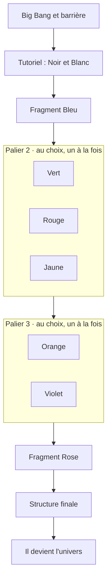

# Complete Universe — Game Design Document

Version finale · 24 novembre 2026

Le détail de chaque pouvoir et de chaque fragment est dans `complete-universe-fiches-fragments.md`.

---

## 1. Vision

**Compléter l'univers.** Un être fait de formes géométriques récupère les fragments de pouvoir dispersés par sa propre explosion, et redonne ses couleurs à un univers noir et blanc.

| Élément | Choix |
| --- | --- |
| Genre | Exploration et plateforme en 2D, énigmes et combats par les pouvoirs |
| Plateformes | PC et Mac d'abord, téléphone ensuite |
| Mode | Solo |
| Durée | 5 à 10 heures |
| Difficulté | Faible : un jeu de découverte plus que de défi |
| Références visuelles | Limbo au début, Ori à mesure que les couleurs reviennent |

**Trois piliers**

1. **Fluide** : se déplacer et changer de pouvoir doit être naturel, sans interface qui coupe l'action.
2. **Progression** : chaque fragment apporte un pouvoir, de nouvelles couleurs et de nouvelles zones à comprendre.
3. **Sombre puis coloré** : le jeu commence en noir et blanc et finit dans un univers entièrement en couleurs.

**Expérience visée** : donner envie de voir la fin. Chaque fragment doit laisser le joueur curieux de la couleur suivante.

---

## 2. Histoire et univers

Le Big Bang, c'est le personnage qui explose et se sépare de ses pouvoirs. Séparé de lui, l'univers s'étend jusqu'à périr. Pour le sauver, il doit récupérer les fragments et redevenir un.

**Ouverture** : une explosion, l'univers s'étend, plein de couleurs, puis de moins en moins, jusqu'au noir et blanc et à un univers semblable au nôtre. La caméra trouve le personnage dans une immense barrière, d'abord en plan large, puis passe en vue de jeu.

**Ce que le joueur sait** : rien. Il comprend seulement qu'il est à part, car il ne voit jamais rien qui lui ressemble. La barrière du début, il l'a créée lui-même, par instinct.

**Les civilisations** : il s'est écoulé tant de temps avant qu'il ne se mette à bouger qu'une infinité de civilisations sont passées, et certaines existent encore. Certaines maîtrisent un ou plusieurs pouvoirs des fragments, jamais plus de deux ou trois. Le joueur peut les détruire ou les laisser en paix, sans grande conséquence.

**Narration** : aucun dialogue compréhensible. Les civilisations parlent, le personnage ne comprend pas. L'histoire passe par les cinématiques, le décor, le retour des couleurs et les fresques au cœur des civilisations, révélées par la lumière du Jaune.

**Fin** : dans la structure finale, les 7 fragments fusionnent avec le personnage. Le noir de l'espace se remplit de couleurs, des nébuleuses partout à la place du vide. Puis la caméra dézoome encore et encore, jusqu'à arriver dans le cœur du personnage : il est devenu l'univers.

---

## 3. Personnage

Une entité humanoïde faite d'ovales, séparée verticalement au milieu du torse : côté droit noir, côté gauche blanc. Son corps reste noir et blanc pendant tout le jeu.

- **Bras** : chaque bras prend la couleur du pouvoir tenu par sa main. C'est le seul indicateur du pouvoir actif.
- **Torse** : chaque fragment récupéré y devient visible. À la fin, les 7 y sont réunis.
- **Pouvoirs** : ils sortent des mains. Le joueur choisit une couleur par main et utilise une main ou les deux à la fois.
- **Animations sans interface** : ouvrir l'inventaire, récolter, se déplacer, recevoir un fragment se voient par les gestes des mains, jamais par un menu.

---

## 4. Boucle de jeu et parcours

Le joueur explore, récolte, utilise ses pouvoirs qui consomment ses récoltes, affronte ennemis et énigmes, trouve une structure, la réussit, obtient le fragment et continue.

Chaque fragment suit le même cycle : récolter sa ressource, se faire guider par le Bleu jusqu'à sa structure, la réussir. Le schéma de ce cycle est dans les fiches fragments.

---

## 5. Contrôles et déplacements

Les contrôles sont standards : le joueur ne gère jamais la gravité lui-même, elle n'est visible qu'à l'écran.

| Action | PC (clavier et souris) |
| --- | --- |
| Se déplacer | Touches de déplacement standard |
| Pouvoir de la main gauche | Clic gauche, vers l'endroit visé |
| Pouvoir de la main droite | Clic droit, vers l'endroit visé |
| Fusion des deux mains | Clic gauche + clic droit en même temps |
| Changer la couleur d'une main | Touche de changement + clic de la main : couleur suivante |
| Roue des couleurs | Maintenir la touche de changement |
| Récolter | Touche dédiée : met Noir et Blanc dans les mains, puis rend les couleurs d'avant une fois la récolte finie |
| Inventaire | Touche inventaire |

**Marcher** : le personnage augmente la gravité là où tombent ses pas pour attirer ses jambes. Cela consomme du Noir, mais très peu.

**Sauter** : il crée un mini trou noir au-dessus de lui. Plus le trou noir est gros, plus le saut est haut et moins il est précis. Un très gros saut peut l'envoyer en orbite. Beaucoup de planètes sont pleines de grottes et de tunnels pour éviter les départs accidentels.

**Quitter une planète** : quand il réduit sa gravité à rien, un saut le fait s'envoler.

**Voyage spatial** : 5 à 10 secondes, sans contrôle. Le personnage dérive vers une nouvelle planète. La caméra, l'angle et le zoom changent pendant le trajet pour montrer qu'il part dans une direction aléatoire, sans retour possible.

**Téléphone** : contrôles à définir (voir Questions ouvertes).

---

## 6. Pouvoirs et fusions

9 pouvoirs : Noir et Blanc dès le début, puis un par fragment. Seuls le Noir, le Blanc et le Bleu fusionnent avec les autres couleurs. Bleu + n'importe quelle couleur indique la direction de la ressource de cette couleur, une couleur à la fois.

| Pouvoir | Effet seul | Ressource | Coût (provisoire) | + Noir | + Blanc |
| --- | --- | --- | --- | --- | --- |
| Noir | Trou noir : gravité, sauts, récolte, écrase un objet jusqu'à l'anéantir | Matière | Très faible pour marcher, élevé pour détruire | — | Récolte et inventaire ; un trou noir au centre d'un astre lui donne une gravité |
| Blanc | Barrière : ce qui est dedans ne subit rien de l'extérieur, ni le temps ; peut être plane, entre deux choses | Carbone | Moyen | voir Noir | — |
| Bleu | Perception : particules de la main bleue vers la ressource de la couleur tenue dans l'autre main, ou vers le prochain fragment | Écho originel | Faible, continu | Vue panoramique | Zone d'analyse : tout ce qui la traverse est scanné ; révèle une couleur non débloquée |
| Vert | Évolution : accélère la croissance, fait évoluer les ennemis | Biomasse | Moyen | Anti-biomasse : n'agit que sur la biomasse, sans abîmer ce qui est dessous | Bulle-source de Vert, déplaçable |
| Rouge | Laser continu ; rebondit sur les barrières, disparaît dans un trou noir | Matière instable | Élevé | Trou noir instable, destruction amplifiée | Laser précis, découpes délicates |
| Jaune | Lumière émise par la main qui tient le Jaune ; alimente les structures, manipule les ombres | Photons | Faible | Lumière noire : assombrit une zone trop éclairée | Source de lumière dans une barrière, déplaçable |
| Orange | Accélère le temps d'un objet ou d'une entité | Chronocristaux | Moyen | Remonte le temps | Entité qui accélère le temps autour d'elle |
| Violet | Fait passer le personnage dans un autre plan | Matière exotique | Moyen | Détruit le portail | Crée un portail entre deux plans, un seul à la fois |
| Rose | Lien : deux entités partagent leur état ; apaise une créature | Résonance | Moyen | Grappin gravitationnel | Lien protecteur : A encaisse à la place de B |

---

## 7. Ressources, récolte et inventaire

Les ressources ne servent qu'aux pouvoirs, une par pouvoir. Chaque nouveau fragment débloque la ressource suivante.

| Pouvoir | Ressource | Où la trouver | Rareté |
| --- | --- | --- | --- |
| Noir | Matière (roche, métal, tout solide) | Partout | Très commune |
| Blanc | Carbone | Astéroïdes carbonés, planètes mortes, fossiles | Commune |
| Bleu | Écho originel | Vide profond, loin des étoiles | Moyenne |
| Vert | Biomasse | Planètes vivantes, créatures | Commune dans les régions vivantes |
| Rouge | Matière instable | Volcans, restes de supernova | Rare, dangereuse à récolter |
| Jaune | Photons | Près des étoiles | Abondante près des étoiles, nulle entre elles |
| Orange | Chronocristaux | Près des trous noirs massifs | Rare |
| Violet | Matière exotique | Failles et anomalies spatiales | Rare |
| Rose | Résonance | Autour des êtres conscients et des civilisations | Variable |

**Récolte** : le joueur vise avec la souris. Une bulle de trou noir entourée d'une barrière absorbe un peu de ressource et laisse un trou dans le décor. Plus il reste appuyé, plus la bulle grandit, mais plus elle consomme ; il ne récupère les ressources qu'une fois la récolte finie, il ne peut donc pas récolter à l'infini. Détruire un astre libère tout ce qu'il contient : une planète de roche et de biomasse donne de la matière pour le Noir et de la biomasse pour le Vert.

**Ressource d'une couleur non débloquée** : elle apparaît en noir et blanc. Une zone d'analyse (Bleu + Blanc) peut l'analyser, ce qui la rend récoltable et la montre dans sa couleur.

**Inventaire** : tout est stocké dans le corps, dans des bulles entourées de barrières. Le joueur l'ouvre avec la touche inventaire et voit la quantité de chaque ressource par la taille des bulles, sans chiffres. L'inventaire ne coûte rien et aucun ennemi ne peut le voler.

**Pas de boucle infinie** : faire pousser de la biomasse avec le Vert en consomme un peu plus qu'elle n'en rapporte, et créer un trou noir puis l'absorber est toujours à perte.

---

## 8. Vie, mort et sauvegarde

Le Noir et le Blanc sont la vie du personnage : ils diminuent progressivement pour maintenir son intégrité physique. Les ennemis ne font pas de dégâts directs : ils le forcent à dépenser ses ressources, le Noir et le Blanc pour le mettre en danger, les autres pour le gêner.

| Ressource épuisée | Signal à l'écran | Mort |
| --- | --- | --- |
| Plus de Noir | Les bords de l'écran blanchissent, puis tout l'écran | Il ne peut plus bouger, pour toujours |
| Plus de Blanc | Les bords de l'écran noircissent, puis tout l'écran | Son propre trou noir le consume |

**Comment les ennemis pèsent** : ils repoussent le joueur loin des ressources qu'il vise, sabotent des gisements, ou dressent des barrières qui l'obligent à dépenser pour passer.

**Trous noirs** : entrer dans un trou noir consume le personnage petit à petit. Créer un trou noir puis l'absorber est toujours à perte : impossible de produire de la matière à partir de rien.

**Dans une structure** : on ne peut pas mourir. La structure limite l'usage du Noir et du Blanc sans jamais vider le stock : on ne peut ni tout détruire, ni tout protéger.

**Sauvegarde** : seules la progression des fragments et les ressources autres que le Noir et le Blanc sont enregistrées. Les planètes ne sont jamais sauvegardées, puisqu'on n'y revient pas.

**Réapparition** : après une mort, on comprend que beaucoup de temps a passé. Le personnage réapparaît dans l'espace avec un peu de Noir et de Blanc en stock, et dérive vers une nouvelle planète en récoltant passivement du Noir et du Blanc. Ses autres ressources sont conservées. Idée de cinématique : un trou noir apparaît près de lui pour le ressusciter.

---

## 9. Monde et génération

Le monde est semi-ouvert et se génère au fil de l'avancée : une planète après l'autre, sans retour ni carte. Il se joue en 2D.

| Contenu | Fait main ou aléatoire |
| --- | --- |
| Planètes, biomes, ressources, ennemis | Aléatoire, selon la région et la progression |
| Bâtiments de civilisations, petites structures | Pièces faites main, placées et agencées au hasard |
| Structures des fragments | Entièrement faites main |
| Structure finale | Entièrement faite main |

**Couleurs non débloquées** : tout ce qui appartient à une couleur pas encore récupérée apparaît en noir ou en blanc (planètes, ressources, ennemis, structures, civilisations). Le joueur ne peut le comprendre qu'après avoir obtenu le fragment. Seule la ressource peut être analysée avant, avec une zone d'analyse.

**Biomes** : variés, avec des biomes spéciaux propres à chaque région. Les régions sont décrites dans les fiches fragments.

**Apparition des structures** : la structure d'un fragment apparaît quand le joueur a récolté assez de sa ressource (environ 100 unités, à équilibrer). Le Bleu la guide alors, souvent loin dans l'espace. Pour suivre ce guidage, il consomme cette ressource en continu. Si elle s'épuise avant l'arrivée, la structure se brise et rend un peu de ressource. Le premier guidage, vers le fragment Bleu, est gratuit et prend la forme d'une lumière dans le ciel.

---

## 10. Progression et difficulté

Le jeu n'est pas difficile : la progression vient de la maîtrise des pouvoirs, qui ne s'améliorent jamais.

- **Rythme** : laisser au joueur le temps de bien prendre en main chaque pouvoir avant le suivant. Avec 5 à 10 heures pour 7 fragments, compter 40 à 80 minutes par fragment : découverte du pouvoir, prise en main, récolte des ressources, voyage vers le prochain fragment, résolution de la structure et obtention du fragment.
- **Aucun pouvoir abandonné** : chaque pouvoir doit rester utile jusqu'à la fin. Seul le dernier peut servir moins longtemps.
- **Transitions** : le jeu ne doit pas exiger de passer très vite d'un pouvoir à l'autre.
- **Portes de couleur** : des passages faits de barrières et de couleurs. En les traversant, le personnage reçoit automatiquement les bons pouvoirs dans les mains.
- **Ordre semi-libre** : Bleu imposé, puis Vert, Rouge et Jaune au choix, puis Orange et Violet au choix, puis Rose imposé et la structure finale. Dans un palier, le Bleu guide vers la couleur tenue dans l'autre main, une seule à la fois.
- **Structures** : chaque structure prête son pouvoir pour ses épreuves (énigmes, combats, donjon, créativité). Le joueur le reçoit vraiment à la sortie. Durée cible : 15 à 20 minutes. Une structure ne peut exiger que les pouvoirs obtenus de façon certaine (au palier 2 : Noir, Blanc, Bleu).

---

## 11. Ennemis et civilisations

Les ennemis peuvent prendre toutes les formes. Ce qui les définit, c'est leur façon de forcer le joueur à dépenser ses ressources.

- **Environnement** : astéroïdes, tempêtes cosmiques, trous noirs errants à enfermer dans une barrière.
- **Êtres vivants** : hostiles, passifs ou amicaux. Les hostiles repoussent le joueur ou sabotent les gisements.
- **Constructions et créatures à pouvoirs** : par exemple une tourelle à laser.
- **Récompense** : le joueur affronte les ennemis surtout pour leur prendre leurs ressources.

**Civilisations** : un type de civilisation par couleur (sauf Noir et Blanc) et un par fusion. Chacune maîtrise les pouvoirs de sa couleur ou de sa fusion, donc jamais plus de deux ou trois. Les 6 civilisations Bleu + couleur forment une seule famille, les prospecteurs, qui partagent bâtiments et comportement.

- Elles parlent, mais le personnage ne les comprend jamais.
- Les détruire ou les laisser ne change presque rien à l'histoire.
- Chaque civilisation raconte son histoire par une fresque en son cœur. On ne la voit qu'une fois arrivé au centre de la civilisation, et seule la lumière du Jaune la dévoile, sans la rendre lisible.
- Une civilisation d'une couleur pas encore débloquée apparaît en noir et blanc, et ses pouvoirs restent incompréhensibles. Leurs effets sont pourtant bien réels : par exemple, un laser apparaît comme un trait noir ou blanc et se comporte comme un laser, sans être vraiment visible pour le joueur.

---

## 12. Tutoriel

Le tutoriel se joue sur la seule planète enfermée dans la barrière du début. Il présente le début de l'histoire, les pouvoirs et les mécaniques de base ; il n'a aucun impact sur la suite. Le texte est autorisé pour les contrôles. Chaque notion suit le même schéma : une courte cinématique, puis le joueur essaie.

1. **Cinématique d'ouverture** : le Big Bang, puis le personnage dans la barrière, qui dérive vers la planète.
2. **Mains** : attribuer un pouvoir à une main, avec le texte des contrôles.
3. **Effets** : voir l'effet du Noir, puis du Blanc, puis de la fusion des deux.
4. **Inventaire** : cinématique, puis le joueur l'ouvre.
5. **Récolte** : cinématique, puis le joueur récolte et voit l'inventaire changer.
6. **Déplacements** : cinématique, puis le joueur se déplace.
7. **Sauts** : cinématique, puis le joueur saute.
8. **Manque de Blanc** : le Blanc baisse et les bords de l'écran noircissent. Le joueur récolte du carbone et comprend que n'avoir plus de Blanc, c'est la mort.
9. **Manque de Noir** : même chose, avec les bords qui blanchissent et une récolte de matière.
10. **Départ** : le personnage tente de contrôler son trou noir et fait exploser la planète. La barrière se dissipe et il dérive à nouveau dans l'espace.

---

## 13. Direction artistique

Le jeu passe du noir et blanc façon Limbo à un univers coloré façon Ori. Il doit être très beau, avec beaucoup d'effets visuels.

- **Départ** : noir, blanc et nuances de gris créées par la lumière.
- **Retour des couleurs** : chaque fragment ajoute sa couleur à l'univers, petit à petit. Ce qui appartient à une couleur pas encore débloquée reste en noir ou en blanc.
- **Personnage** : corps noir et blanc pendant tout le jeu, séparé verticalement au milieu du torse (côté droit noir, côté gauche blanc), bras de la couleur du pouvoir tenu, fragments visibles sur le torse.
- **Pouvoirs** : chaque pouvoir sort de la main avec un effet visuel propre et un motif sur le bras. Le guidage du Bleu prend la forme de particules qui filent dans la direction voulue.
- **Fin** : le noir de l'espace se remplit de nébuleuses de toutes les couleurs, puis la caméra dézoome jusqu'au cœur du personnage.

---

## 14. Son

- **Musique** : elle s'enrichit à chaque fragment, comme les couleurs.
- **Pouvoirs** : un son propre par pouvoir.
- **Civilisations** : elles ont des voix et des langages que le joueur ne comprend pas.

---

## 15. Interface et accessibilité

Aucune interface classique à l'écran pendant le jeu : tout passe par le personnage et le décor.

| Information | Comment le joueur la voit |
| --- | --- |
| Pouvoir dans chaque main | La couleur du bras |
| Niveau de Noir et de Blanc | Les bords de l'écran qui blanchissent ou noircissent |
| Ressources | Bulles de l'inventaire (touche inventaire), par leur taille |
| Direction à suivre | Particules du Bleu |
| Fragments obtenus | Le torse du personnage |
| Contrôles | Texte, seulement pendant le tutoriel |

**Menus** : écran titre, pause, options (son, affichage, touches).

**Accessibilité** : dans un jeu fondé sur les couleurs, chaque couleur se reconnaît aussi à un motif sur le bras et à son son, pour les joueurs daltoniens. Touches modifiables.

---

## 16. Production

À compléter : moteur, version minimale, équipe, calendrier, modèle économique.

---

## 17. Questions ouvertes

- [ ] **Guidage et voyage aléatoire** : le voyage entre planètes part dans une direction aléatoire, mais le Bleu guide vers une structure lointaine. Proposition : le point de la planète d'où il s'envole fixe le sens du voyage ; seule la planète d'arrivée est aléatoire.
- [ ] **Mort pendant un guidage** : la structure visée est-elle perdue ?
- [ ] **Recharger une partie** : le joueur repart-il dans l'espace, comme après une mort ?
- [ ] **Contrôles sur téléphone** : disposition des deux mains, de la roue et des déplacements.
- [ ] **Équilibrage** : coûts réels des pouvoirs ; seuil de guidage provisoire à 100 unités.
